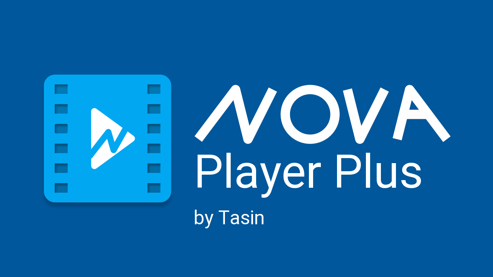
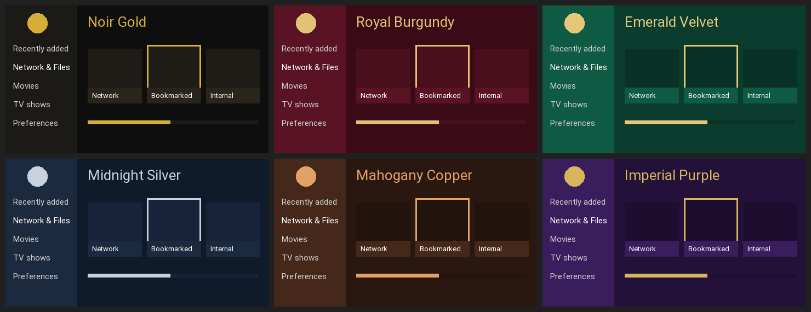

<div align="center">



<h1>Nova Player Plus</h1>

<p><b>A premium video player for Android TV.</b><br>
Stream any link, browse server folders, bookmark what you watch,<br>
choose from eight themes, and update in one click.</p>

<p>
<a href="https://github.com/tasin-py/NovaPlayer-Plus/releases/latest"></a>
<a href="https://github.com/tasin-py/NovaPlayer-Plus/releases"></a>
</p>
<p>
<a href="https://github.com/tasin-py/NovaPlayer-Plus/actions/workflows/prime-release.yml"></a>

<a href="https://github.com/tasin-py/NovaPlayer-Plus/blob/prime/LICENSE.txt"></a>
<a href="https://www.supportkori.com/tasinpy"></a>
</p>

<h3>
<a href="https://github.com/tasin-py/NovaPlayer-Plus/releases/latest">⬇ Download</a>
&nbsp;·&nbsp; <a href="#-features">Features</a>
&nbsp;·&nbsp; <a href="#-themes">Themes</a>
&nbsp;·&nbsp; <a href="#-install">Install</a>
&nbsp;·&nbsp; <a href="#-faq">FAQ</a>
&nbsp;·&nbsp; <a href="#-support">Support</a>
</h3>

</div>

---

## ✨ Highlights

<table>
<tr>
<td align="center" width="25%"><h3>🔗</h3><b>Stream any link</b><br><sub>Paste it and play. Direct files, HLS, DASH, RTSP, Drive, Dropbox, OneDrive</sub></td>
<td align="center" width="25%"><h3>📂</h3><b>Browse server folders</b><br><sub>Folder links open as a list you can explore</sub></td>
<td align="center" width="25%"><h3>🔖</h3><b>Bookmarks</b><br><sub>Saved until you remove them, right on the home screen</sub></td>
<td align="center" width="25%"><h3>🎨</h3><b>Eight themes</b><br><sub>Six premium themes plus the classic Blue and Black</sub></td>
</tr>
<tr>
<td align="center"><h3>🎬</h3><b>Details first</b><br><sub>See title, size and server before anything plays</sub></td>
<td align="center"><h3>⬆️</h3><b>One-click updates</b><br><sub>A red dot tells you, one press installs</sub></td>
<td align="center"><h3>🏠</h3><b>Made for the couch</b><br><sub>Built for the TV remote, from home screen to settings</sub></td>
<td align="center"><h3>🎞️</h3><b>All of NOVA inside</b><br><sub>Every NOVA feature, unchanged</sub></td>
</tr>
</table>

## 🚀 Features

### 🔗 Stream
Open **Network › Stream**, then type or **Paste** a link and choose **Open**.

- **Direct video files** (mkv, mp4, avi…) over http and https
- **Live and adaptive streams:** HLS (`.m3u8`), DASH, RTSP, RTMP, UDP
- **Cloud share links:** Google Drive, Dropbox and OneDrive links are turned into direct links automatically
- **Recent streams** stay in a list for 30 days

### 📂 Server folders
Paste the link of a folder on a media server (h5ai, nginx, Apache and similar listings), and it opens as a browsable list:

- Sub-folders first, then videos, each with its size
- Open a sub-folder to keep exploring, the same way as on the website

### 🎬 Details before playing
A video never starts by surprise. Its page shows the **title, file name, size and server** first, with **Play** and **Bookmark**.

### 🔖 Bookmarks
- **Bookmark this folder** sits at the top of every folder; **Bookmark this video** sits under Play
- Bookmarks are kept until you remove them
- Find them in two places: on the **Stream** screen, and in **Bookmarked** on the home screen

### 🏠 Home screen
- **Network & Files** is the 2nd row, right under *Recently added*
- **Bookmarked** sits right next to *Network*, one click away

### ⬆️ One-click updates
- Checks for a new version at most every 6 hours, or on demand with **Settings › Nova Player Plus › Check for updates**
- A **red dot** on Settings means an update is ready; **Update now** downloads and installs it
- Picks the right file for your device automatically and only downloads from GitHub over HTTPS

### 🎞️ Everything from NOVA
Nova Player Plus keeps every feature of NOVA Video Player, untouched: local and network playback (SMB, UPnP, FTP, SFTP, WebDAV and more), hardware decoding, subtitles, audio passthrough, resume where you left off, automatic movie and TV show info with posters, and much more.

## 🎨 Themes

Choose in **Preferences › Theme**. Each theme recolors the background, side menu, tiles, highlights, progress bars and settings.

<div align="center">

</div>

| Theme | Style |
|---|---|
| **Noir Gold** | Deep black and gold, like a classic cinema |
| **Royal Burgundy** | Rich wine red with champagne gold |
| **Emerald Velvet** | Dark emerald green with soft gold |
| **Midnight Silver** | Midnight navy with silver |
| **Mahogany Copper** | Warm dark wood with copper |
| **Imperial Purple** | Royal purple with gold |
| Blue · Black | NOVA's original themes |

## 📥 Install

1. Open the **[latest release](https://github.com/tasin-py/NovaPlayer-Plus/releases/latest)**.
2. Download the file for your device:

   | Your device | Download |
   |---|---|
   | **Most Android TVs** (TCL, Sony, Philips, Hisense…) | `prime-armeabi-v7a.apk` |
   | **Newer TVs, Google TV, phones and tablets** | `prime-arm64-v8a.apk` |
   | Emulators and PCs | `prime-x86_64.apk` · `prime-x86.apk` |

   Not sure? Try `prime-armeabi-v7a.apk` first. It works on almost every TV.
3. Open the file to install it. You may need to allow installing from unknown sources once.
4. Done. Future updates come through **Check for updates**.

### Works on
| ✅ Supported | ❌ Not supported |
|---|---|
| Android TV and Google TV (Android 6.0 or newer) | LG TVs (webOS) |
| Chromecast with Google TV, Google TV Streamer | Samsung TVs (Tizen) |
| Amazon Fire TV sticks and boxes (by sideloading) | Roku |
| Android boxes, phones and tablets | Apple TV |

> **Have an LG, Samsung or other non-Android TV?** Plug an Android streaming stick into an HDMI port, such as a Chromecast with Google TV, a Fire TV Stick or a Mi Box, and install Nova Player Plus on it.

## ❓ FAQ

<details>
<summary><b>I already have NOVA Video Player. Can I install both?</b></summary>
<br>
No. Nova Player Plus replaces NOVA, because both use the same app ID. Uninstall NOVA first, then install Nova Player Plus. Your NOVA library and settings won't carry over.
</details>

<details>
<summary><b>How do I update?</b></summary>
<br>
Go to <b>Settings › Nova Player Plus › Check for updates</b>. When an update is available, Settings shows a red dot and <b>Update now</b> installs it. You can also download the newest file from the <a href="https://github.com/tasin-py/NovaPlayer-Plus/releases/latest">latest release</a> and install it over the old one.
</details>

<details>
<summary><b>A link won't play. What can I do?</b></summary>
<br>
Make sure the link is complete, with nothing extra copied before or after it, and that it points to a video or a folder, not a web page. If the server is slow or busy, try again later. If the details page can't read the file, choose <b>Try to play it anyway</b>.
</details>

<details>
<summary><b>Does it collect any data?</b></summary>
<br>
Nova Player Plus adds no tracking or ads. Its own features only contact GitHub (to check for updates) and the links you choose to open. NOVA's online features, like fetching movie posters and info, work exactly as they do in NOVA.
</details>

## 🛠 For developers

<details>
<summary><b>How the code is organised</b></summary>
<br>

| Branch | Contents |
|---|---|
| `prime` | Build setup: the `prime.xml` manifest and the release workflow |
| `prime-video` | The app itself. Nova Player Plus code is in `src/main/java/com/archos/mediacenter/video/prime/` |
| `nova` | NOVA's original repository, kept for reference |

The fork's code lives in its own `prime` package and its own resource files.
NOVA's files only get a few small hooks marked `// NovaPlayer Prime`, so merging NOVA updates stays simple.
</details>

<details>
<summary><b>Building and releasing</b></summary>
<br>

Releases are built on **GitHub Actions**. Every push to `prime` builds signed APKs and publishes a release tagged `prime-<versionCode>`; you can also run *Actions › NovaPlayer Prime release › Run workflow*.

Signing uses four repository secrets: `PRIME_KEYSTORE_BASE64`, `PRIME_KEYSTORE_PASSWORD`, `PRIME_KEY_ALIAS` and `PRIME_KEY_PASSWORD`.
Always use the same keystore: Android refuses updates signed with a different key.
</details>

<details>
<summary><b>Pulling in NOVA updates</b></summary>
<br>

```bash
cd Video
git fetch https://github.com/nova-video-player/aos-Video.git v6.6
git merge FETCH_HEAD
git push https://github.com/tasin-py/NovaPlayer-Plus.git HEAD:prime-video
```

When NOVA moves to a new branch (for example v6.7), update the revisions in `prime.xml` to match their newest manifest.
</details>

## 💛 Support

If Nova Player Plus makes your evenings better, you can support its development:

<div align="center">

<a href="https://www.supportkori.com/tasinpy"></a>
<a href="https://github.com/tasin-py"></a>

⭐ **Starring this repository** also helps other people find it.<br>
Found a bug or have an idea? [Open an issue](https://github.com/tasin-py/NovaPlayer-Plus/issues).

</div>

## 🙏 Credits

Nova Player Plus is built on **NOVA Video Player**, the open-source video player by the NOVA developers (Courville Software and contributors), which grew out of the **Archos Video Player** Community Edition. All credit for the player, its media engine and every original feature goes to them.

Forked, designed and maintained by **[tasin-py](https://github.com/tasin-py)**.

| Original project | Link |
|---|---|
| NOVA Video Player | [github.com/nova-video-player/aos-AVP](https://github.com/nova-video-player/aos-AVP) |
| NOVA's app code | [github.com/nova-video-player/aos-Video](https://github.com/nova-video-player/aos-Video) |
| Support the NOVA developers | [liberapay.com/NovaVideoPlayer](https://liberapay.com/NovaVideoPlayer/donate) |
| Archos Video Player (the origin) | [github.com/archos-sa/aos-AVP](https://github.com/archos-sa/aos-AVP) |

<div align="center">
<br>
<sub>Licensed under the <a href="https://github.com/tasin-py/NovaPlayer-Plus/blob/prime/LICENSE.txt">Apache License 2.0</a>, like NOVA.<br>
Made with ❤️ by Tasin</sub>
</div>
